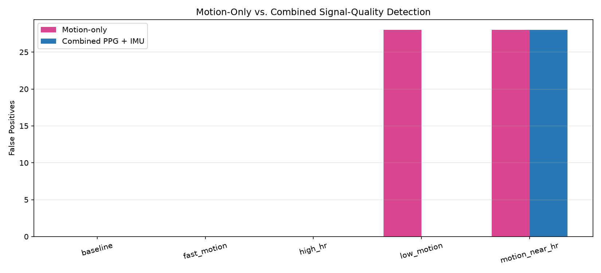
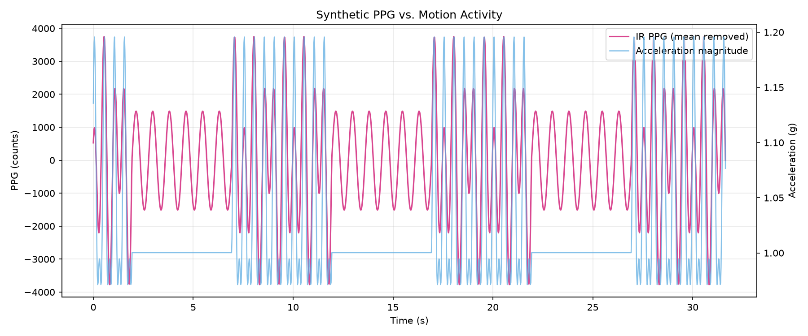

# Motion-Aware Physiological Sensing System

An embedded physiological sensing system designed to investigate motion artifacts in photoplethysmography (PPG) and improve the reliability of heart-rate measurements using inertial sensor data.

The project integrates an **ESP32-S3 microcontroller**, **MAX30102 optical PPG sensor**, and **MPU6050 inertial measurement unit (IMU)** with a Python-based data acquisition and signal-processing pipeline.

The goal is to distinguish between movement that interferes with physiological measurements and movement that does not, rather than rejecting all measurements collected during motion.

**Status:** In development — synthetic signal-processing pipeline implemented and evaluated; physical sensor integration pending.

## System Architecture

```text
                  ESP32-S3
                     |
          +----------+----------+
          |                     |
       MAX30102               MPU6050
      PPG Sensor              6-Axis IMU
          |                     |
          +----------+----------+
                     |
              USB Serial
                     |
             Python Acquisition
                     |
              CSV Data Logging
                     |
            Signal Processing
                     |
          +----------+----------+
          |                     |
      PPG Analysis          IMU Analysis
      - Filtering           - Motion intensity
      - FFT / HR            - Frequency content
      - Spectral power      - Motion features
          |                     |
          +----------+----------+
                     |
          Motion-Aware Quality
                Assessment
                     |
          Reliable / Flagged HR
```

*The architecture represents the intended hardware system. Current DSP and evaluation results use synthetic PPG and IMU measurements generated by the ESP32-S3 and Python test scripts.*

## Hardware

| Component | Purpose |
|---|---|
| ESP32-S3-DevKitC-1-N16R8 | Embedded acquisition and processing |
| MAX30102 | Red and infrared optical PPG measurements |
| MPU6050 | Three-axis acceleration and angular velocity |
| Breadboard and jumper wires | Initial sensor prototyping |

Both sensors will communicate with the ESP32-S3 over I²C.

Planned pin assignments:

| ESP32-S3 | Sensor connection |
|---|---|
| GPIO8 | SDA |
| GPIO9 | SCL |
| 3V3 | Sensor power, subject to breakout compatibility |
| GND | Common ground |

## Software

**Firmware**
- C++ using Arduino framework and PlatformIO
- ESP32-S3 USB serial communication
- 50 Hz synthetic PPG and IMU data generation
- Timestamped CSV-formatted output
- I²C device scanner for hardware bring-up

**Python**
- Serial acquisition using PySerial
- Data processing with NumPy, Pandas, and SciPy
- Visualization using Matplotlib
- FFT-based heart-rate estimation
- Sliding-window signal analysis
- IMU motion feature extraction
- Spectral motion-artifact detection
- Synthetic test generation and detector evaluation

## Signal Processing and Motion-Aware Detection

The current pipeline estimates heart rate from the dominant frequency of the PPG signal using a sliding-window FFT.

A baseline motion detector uses accelerometer-derived motion intensity to flag potentially unreliable estimates. However, movement does not necessarily corrupt the PPG signal, so this approach can reject otherwise accurate measurements.

The combined detector incorporates three conditions:

1. Significant motion is detected by the IMU.
2. Dominant PPG and IMU frequencies are sufficiently close.
3. The PPG contains substantial spectral energy near the motion frequency.

This approach attempts to identify motion-related interference rather than relying on movement intensity alone.

### Preliminary Results

The motion-only and combined detectors were compared across five synthetic test conditions with different heart rates, motion frequencies, and artifact amplitudes.

| Metric | Motion-only | Combined PPG + IMU |
|---|---:|---:|
| Incorrect HR estimates detected | 84/84 | 84/84 |
| False positives | 56 | **28** |
| False negatives | 0 | 0 |
| Precision | 60% | **75%** |
| Recall | 100% | 100% |
| HR estimate retention | 50% | **60%** |

The combined detector reduced false-positive reliability flags by **50%** while preserving detection of all HR errors in the development tests.

These results are preliminary and based entirely on synthetic data. The same datasets were used during algorithm development, so the results do not establish performance on unseen signals or physical sensor measurements.

### Detector Comparison



### Motion Artifact Visualization



## Repository Structure

```text
motion-aware-physio/
├── firmware/
│   ├── src/
│   │   └── main.cpp
│   ├── examples/
│   │   └── i2c_scanner.cpp
│   └── platformio.ini
│
├── analysis/
│   ├── acquisition/
│   ├── signal_processing/
│   ├── visualization/
│   ├── testing/
│   └── requirements.txt
│
├── data/
│   ├── raw/
│   └── processed/
│
├── docs/
│   ├── roadmap.md
│   ├── engineering-log.md
│   ├── experimental-protocol.md
│   └── images/
│
├── hardware/
│
└── README.md
```

## Development Progress

**Completed**
- [x] ESP32-S3 development environment and USB serial communication
- [x] I²C scanner implementation
- [x] Synthetic PPG and IMU data generation at 50 Hz
- [x] Python serial acquisition and CSV logging
- [x] PPG and IMU signal visualization
- [x] FFT-based heart-rate estimation
- [x] Sliding-window heart-rate analysis
- [x] IMU motion intensity and frequency extraction
- [x] Motion-only reliability detector
- [x] Combined PPG + IMU spectral reliability detector
- [x] Quantitative comparison across five synthetic test conditions

**Next Steps**
- [ ] Validate detector performance on held-out synthetic datasets
- [ ] Evaluate irregular motion and varying heart rates
- [ ] Investigate additional PPG signal-quality features
- [ ] Integrate MPU6050 and MAX30102 hardware
- [ ] Acquire synchronized measurements from physical sensors
- [ ] Evaluate motion artifacts during controlled movement
- [ ] Refine the detector using real physiological measurements

See [Development Roadmap](docs/roadmap.md) for detailed milestones and [Engineering Log](docs/engineering-log.md) for implementation notes and experimental results.

## Current Limitations

The present evaluation uses synthetic physiological and motion signals with controlled characteristics. Real PPG measurements contain additional sources of variability, including sensor placement, contact pressure, ambient light, and physiological differences.

The current frequency-based approach also has limited ability to distinguish cardiac activity from motion when their dominant frequencies are close together.

Future work will focus on independent validation, real sensor acquisition, and more robust signal-quality assessment.

## Tools and Technologies

**Embedded:** ESP32-S3, C++, Arduino, PlatformIO, I²C, USB Serial

**Signal Processing:** Python, NumPy, SciPy, Pandas, FFT, spectral analysis

**Visualization and Development:** Matplotlib, VS Code, Git, GitHub